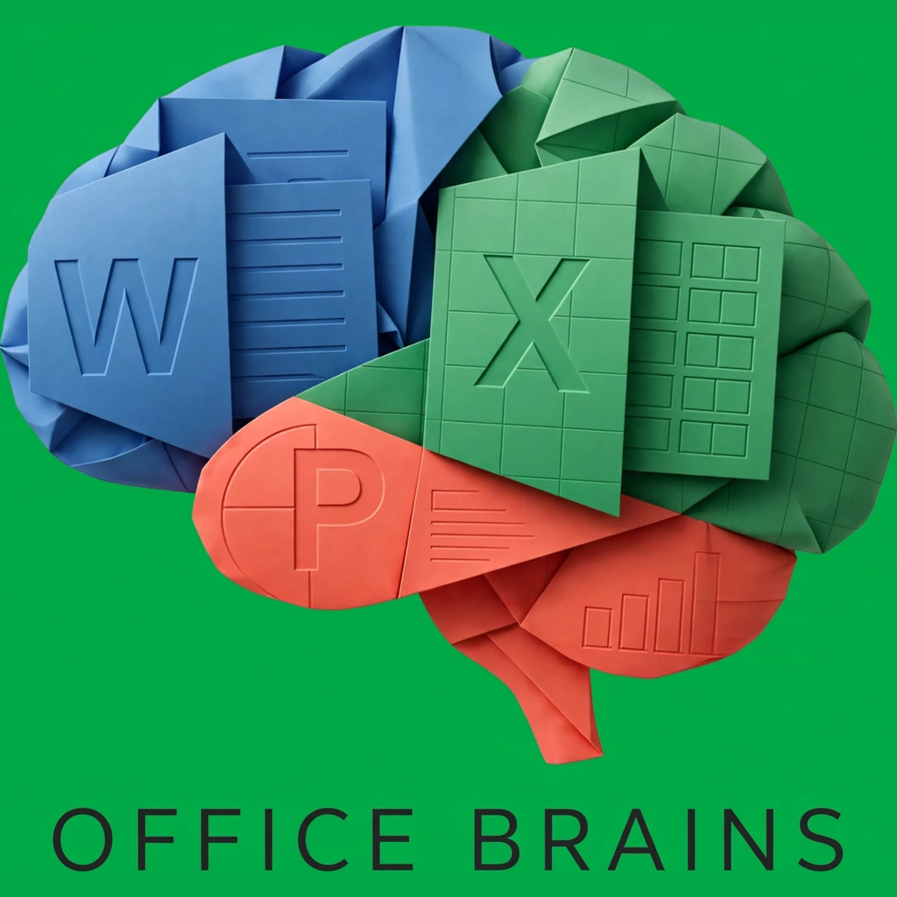

# AGENTS.md — Office Brains operator manual

> You are an AI agent. This file tells you how to install and operate
> **Office Brains** (`brains`), the document compiler that turns your JSON
> intent into forensic-grade `.docx` / `.xlsx` / `.pptx` files.



## 1. Install (pick one)

**Binary (fastest, no toolchain):** download `brains-<os>-<arch>` from the
latest GitHub Release into PATH, then `brains doctor`.

**From source:** `git clone https://github.com/DERYK-RYLOY/office-brains.git && cd office-brains && go build -o brains ./cmd/brains`
(Go 1.22+, zero dependencies, fully offline after build).

**Windows one-liner:** `irm https://raw.githubusercontent.com/DERYK-RYLOY/office-brains/main/install.ps1 | iex`

## 2. The contract (read carefully)

- **You never write XML.** You write **OIR JSON** (`pkg/spec/oir.schema.json`,
  versions `"1.0"`/`"1.1"`). The compiler owns all OOXML.
- **stdout = JSON data. stderr = logs + errors.** Parse stdout, read stderr
  for `{"ok":false,"error":CODE}`.
- **Stable error codes:** `ERR_OIR_*` (bad spec), `ERR_PATCH_*` (bad patch),
  `ERR_VALIDATE_FAILED`, `ERR_CREATE_*`, `ERR_ORACLE_*`. Switch on `error`,
  show the user `detail`.
- **Exit codes:** `0` ok, `1` validation/oracle failure, `2` usage/spec error.
- **`--human`** switches stdout to people-text. `NO_COLOR=1` is respected
  (we emit no color codes, ever).

## 3. The happy path (every task)

```sh
brains doctor                                          # health matrix
brains create --spec job.json --type docx -o out.docx --validate
brains oracle check --file out.docx                    # independent libraries
brains see --spec job.json --type docx -o see.png      # LOOK at it
```

Block types: `h1 h2 p bullet code image chart table`.
One section = one sheet (xlsx) / one slide (pptx).
`chart` needs `kind: bar|line|pie`, `labels[]`, `series[{name, values[]}]`
(values must be finite; `kind` anything else is `ERR_OIR_CHART_KIND`).
Table cells: `"text"` | `123` | `true` | `{"f":"SUM(A1:A2)","v":3}` —
formulas REQUIRE cached `v` or Excel shows text.

## 4. Fix loop (do not rewrite whole specs)

```sh
brains patch --spec job.json --patch ops.json -o job2.json \
  --type docx --out-file out2.docx --validate
# ops: [{"op":"replace","path":"/doc/sections/0/blocks/1/txt","value":"Fixed"}]
brains see --spec job2.json --type docx -o see2.png      # re-look
```

Array inserts/appends are unsupported by design: `replace` the whole array.
`remove` works on object keys only. See `patch --help` behavior in errors.

## 5. Vision loop (you have eyes — use them)

1. `see` returns a PNG **and** a math audit (`pptx.slide_full`,
   `xlsx.wide_col`, `docx.long_cell`, or `layout.clean`).
2. An `error`-severity issue means the file WILL drop content — split the
   content across sections before building, not after.
3. After patching, screenshot again and diff:
   `python oracle/diff_png.py before.png after.png` → `changed_pct` + bbox
   proves the fix landed visually.

## 6. Guarantees you can rely on

- `--frozen`: same spec → byte-identical file (fixed clock + counter IDs).
- `forge --file in -o out`: replaces metadata only; body passes through
  byte-identical. Refuses `in == out`.
- `create --golden dir`: clones real `blank.docx/xlsx/pptx` when present;
  image/chart/header specs fall back to clean builds with a logged reason.
- Caps (all coded, never panics): 50 sections, 500 table rows, 20 images,
  10 charts, 8MB images, 100k-char text, 100 patch ops.

## 7. Limits (tell the user, don't hide)

- Widths are estimates (no glyph shaping); dense sheets can drift slightly.
- DOCX charts render as data tables; bar/line/pie are native on xlsx/pptx.
- No custom fonts (Calibri family), no diagrams/shapes, one header/footer.
- `see` shows the faithful preview, not the binary — glyph truth needs Word.
- Pixel parity with Word is impossible for any non-Microsoft tool.
