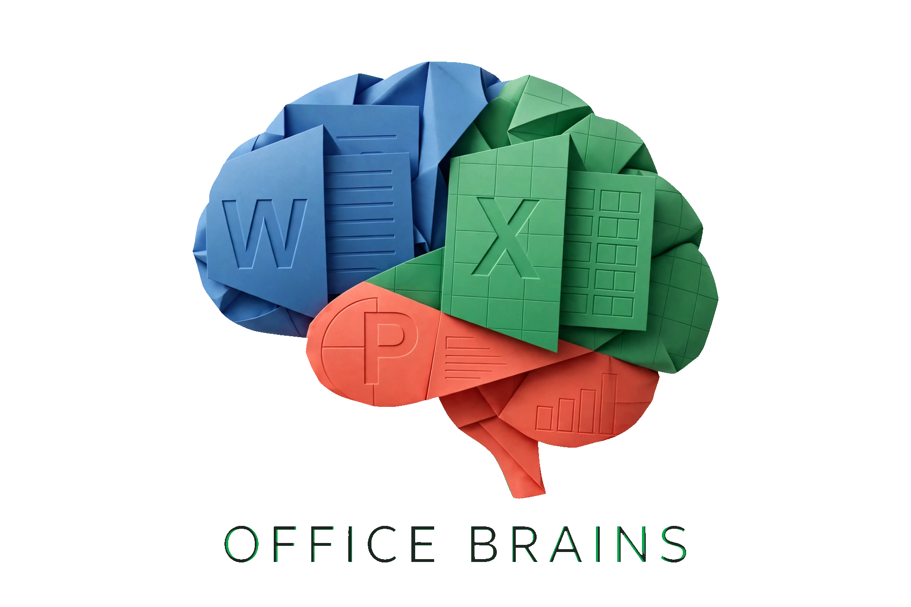

<p align="center"></p>

# OFFICE BRAINS

**The document compiler for AI agents.** You write JSON intent —
`brains` compiles it into clean, Transitional, forensically-quiet
`.docx` / `.xlsx` / `.pptx`.

[](https://github.com/DERYK-RYLOY/office-brains/actions)


> ⭐ If this builds your documents, star the repo — it keeps the project alive.

## Why it exists

AI-written Office files look fake, break on open, or silently drop content.
Office Brains fixes the architecture, not the prompt:

- **OIR compiler** — agents describe *what* (JSON), never *how* (XML).
- **Forensic forge** — real author/company/timestamps, zero `python-docx`-style traces.
- **Native everything** — tables, `SUM` formulas with cached values, bar/line/pie charts in **all three formats** (including native Word charts), images, merges, multisheet/multislide.
- **Deterministic** — `--frozen` makes the same spec byte-identical, every run.
- **Oracle squad** — every file re-opened by independent libraries (openpyxl, python-pptx, python-docx) before it ships. Now works from binary installs and installs are hash-checked.
- **Vision loop** — `see` renders + screenshots + audits layout so the agent *looks* before delivering — images and charts included.

## Who it's for

**AI agents first, humans second.** Any harness that can run a CLI and parse
JSON — Claude Code · Cursor · Windsurf · Cline · Aider · OpenCode ·
Gemini CLI · Codex CLI · Copilot CLI — full operator manual in `AGENTS.md`.

## The 60-second tour

```powershell
irm https://raw.githubusercontent.com/DERYK-RYLOY/office-brains/main/install.ps1 | iex
brains doctor
brains create --spec job.json --type docx -o out.docx --validate
brains see --spec job.json --type docx -o see.png   # look at it
```

## Install

**Option A — binary (no Go needed, recommended for most people):**

1. Open the latest GitHub Release, download `brains-windows-amd64.exe`
   (or `brains-linux-amd64`) — or run the one-liner below; it verifies SHA-256
   against `SHA256SUMS.txt` from the same release and refuses to install on mismatch.
2. Run `brains doctor`. Done — creating files works fully offline.

Windows: `irm https://raw.githubusercontent.com/DERYK-RYLOY/office-brains/main/install.ps1 | iex`
Linux: `curl -fsSL https://raw.githubusercontent.com/DERYK-RYLOY/office-brains/main/install.sh | sh`

Override the release tag with `$env:BRAINS_TAG` / `BRAINS_TAG` (default v0.2.0).

**Option B — from source (developers):**

```powershell
git clone https://github.com/DERYK-RYLOY/office-brains.git
cd office-brains
go build -o brains ./cmd/brains
```

Requires Go 1.22+. No dependencies outside the standard library.

**Oracle (optional, strict checking):**

```powershell
.\brains oracle setup    # portable Python 3.12 + pinned, hash-checked pip packages into .oracle/
```

Windows only today (`oracle setup` fetches the Windows embeddable build; downloads
are SHA-256-pinned and pip runs `--require-hashes`). Binary installs need nothing
from the repo — the scripts are embedded in the binary and materialized into
`.oracle/` on first run; root discovery walks upward from the cwd and from the
exe directory (`BRAINS_ORACLE_ROOT` overrides). On Linux/macOS:
`pip install --require-hashes -r oracle/requirements-hashes.txt`, then
`oracle check` finds `python3` on PATH. Everything else runs anywhere Go runs.

## OIR — the input contract

Agents never write XML. They write `pkg/spec/oir.schema.json`-validated JSON:

```json
{"oir": "1.1", "doc": {"sections": [
  {"name": "Q4", "blocks": [
    {"t": "h1", "txt": "Q4 Financials"},
    {"t": "table", "rows": [["Product","Rev"],["A",100]]},
    {"t": "chart", "kind": "bar", "title": "Rev",
     "labels": ["A"], "series": [{"name": "2026", "values": [100]}]}
  ]}
]}}
```

Block types: `h1 h2 h3 p bullet code quote divider pagebreak toc image chart table`.
Sections become sheets (xlsx) / slides (pptx). `pagebreak` starts a new slide in pptx.

## Commands

| Command | Purpose |
|---|---|
| `create --spec --type -o` | Build a file. Flags: `--profile`, `--company`, `--dna`, `--golden`, `--frozen`, `--validate`, `--strict`, `--human` |
| `patch --spec --patch -o` | RFC6902 ops (`replace`/`add`/`remove`) on a spec, optional `--type/--out-file/--validate` build |
| `inspect --file` | Parts + provenance scan |
| `validate --file [--xsd dir]` | Offline OOXML checks, optional xmllint XSD gate |
| `forge --file -o` | Replace `docProps` per profile, body byte-identical. Never overwrites in place |
| `diff --a --b` | Part-level diff with SHA + ignored `docProps` |
| `preview --spec --type -o` | Self-contained HTML preview, same math as emitters |
| `shot --html -o` | Headless-Edge PNG screenshot (zero installs) |
| `see --spec --type -o` | Preview + screenshot + layout audit in one call (VLM eyes) |
| `oracle setup\|check` | Auto-downloaded strict validators; open files with reference libs |
| `dna learn <dir> -o` | Learn company/author lineage from a corpus |
| `serve --port` | Localhost-only inspect/validate API |
| `doctor` | Environment + engine matrix |

Output contract: **stdout = JSON data, stderr = logs + `{"ok":false,"error":CODE}`**.
Stable codes: `ERR_OIR_*`, `ERR_PATCH_*`, `ERR_VALIDATE_FAILED`, `ERR_CREATE_*`.
Exit codes: `0` ok · `1` validation/oracle failure · `2` usage/spec error · `3` content dropped/truncated (`--strict` on `create`/`patch`).
`--human` switches stdout to people text. `NO_COLOR=1` respected (no color emitted, ever).

## Oracle squad (strict third-party validation)

Our own `validate` checks structure. The oracle opens every file with the
independent reference libraries — anything THEY reject is our bug:

| Package | Version | Job in the suite |
|---|---|---|
| Pillow | 12.3.0 | Real Calibri glyph measurement (`oracle/measure.py`) — the upgrade path for column widths |
| python-pptx | 1.0.2 | Strict PPTX open; shape/table/chart/picture inventory |
| openpyxl | 3.1.5 | Strict XLSX open; sheets, dimensions, merges, drawings |
| XlsxWriter | 3.2.9 | Chart/image gold standard reference |
| python-docx | 1.2.0 | Strict DOCX open; paragraphs, tables, images, author |
| lxml | 6.0.1 | Byte-strict XML parsing of every part (caught our `p:xfrm`/`a:xfrm` bug) |

Setup downloads automatically, isolated — no system Python touched, no admin:

```powershell
.\brains oracle setup    # portable Python 3.12 + pinned pip packages into .oracle/
.\brains oracle check --file out.docx --file out.xlsx --file out.pptx
```

`oracle/requirements.txt` pins every version. `.oracle/` is git-ignored.

## Vision loop (AI eyes, zero installs)

Humans catch "looks off" instantly; blind agents can't. The loop:

```powershell
.\brains see --spec job.json --type pptx -o see.png
# -> PNG for the VLM + math issues (overflow %, drops) in one call
.\brains patch --spec job.json --patch fix.json -o job2.json
.\brains see --spec job2.json --type pptx -o see2.png
.\brains oracle check --file out.pptx   # strict re-verify
```

- `see` = `preview` + headless Edge screenshot + `vision.Issues` audit.
  Single round trip: pixels for the VLM, rules for the code.
- Rules today: `pptx.visual_dropped` (error — content WILL drop),
  `pptx.visual_scaled` (warn — shrunk to fit), `pptx.image_missing`,
  `pptx.crowded`, `xlsx.wide_col/grid`, `docx.many_cols/long_cell`,
  plus `layout.clean`.
- `oracle/diff_png.py` diffs before/after PNGs (changed %, bbox) to prove
  the fix worked visually.
- Honest limit: the VLM sees the faithful preview (same constants as the
  emitters), not the binary. Glyph-level truth still needs Word/Excel.

## Golden transplant

Drop real Microsoft blanks next to the binary dir to clone instead of generate:

- `golden/blank.docx`, `golden/blank.xlsx`, `golden/blank.pptx`

then `create --golden golden`. Text/table specs transplant (styles/theme stay
Microsoft-original); image/chart/header specs fall back to clean builds.

Never commit licensed Microsoft files.

## Repo layout

```
AGENTS.md / SKILL.md  Agent operator manual + skill card (start here, agents)
cmd/brains        CLI (cobra-free, stdlib flags)
internal/oir      Spec + validation (coded errors, BOM-tolerant)
internal/compiler docx/xlsx/pptx emitters + charts + shared slide layout (EMU)
internal/surgeon  Deterministic ZIP + golden transplant
internal/forger   Metadata (incl. --frozen deterministic mode)
internal/layout   Column/table width solvers
internal/verify   Offline checks + optional XSD gate
internal/vision   Layout audit: same layout pass as the emitter, translated to issues
internal/patch    RFC6902 subset for specs
internal/preview  OIR -> HTML (data-URI images, inline-SVG charts)
internal/dna      Corpus lineage learning
internal/media    PNG/JPEG loading (stdlib)
oracle/           Strict validators (verify.py, measure.py, diff_png.py) + hash-pinned requirements; embedded in the binary
assets/           Brand: banner.png hero + logo.png mark
pkg/spec          oir.schema.json + example specs
golden/           Your blanks live here (empty, git-ignored)
CHANGELOG.md      What changed per release
LICENSE-MIT       MIT text covering v0.1.0 only
```

## Limits (honest)

- Widths are approximations (no glyph shaping); dense sheets can drift low single digits
- PPTX visuals that don't fit are **scaled to fit** the remaining slide space (warned); only genuinely unplaceable ones drop (warned) — `--strict` makes drops exit 3
- No custom fonts (Calibri family), no diagrams/shapes, one header/footer
- A `toc` block is a Word TOC field — Word populates it on open (`w:updateFields`); until then it shows placeholder text
- Pixel parity with Word is impossible for any non-Microsoft tool
- 50 sections, 500 table rows, 20 images, 10 charts, 8MB image caps

## License

Business Source License 1.1 — free for non-production and for contributors
who submit their work back; production use needs a commercial license.
Every version converts to Apache 2.0 four years after release. See LICENSE.
(v0.1.0 remains under its original MIT license — the MIT text ships as `LICENSE-MIT`.)

Change log: `CHANGELOG.md`. Want to help? See CONTRIBUTING.md — issues with repro specs welcome.
